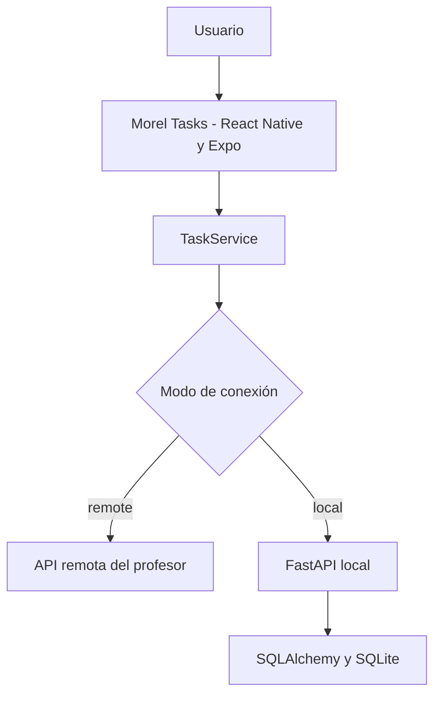

Morel Tasks – cmorel
Estudiante: Andrea Morel
Materia: Programación III
Objetivo del proyecto
Desarrollar una aplicación móvil de gestión de tareas con una interfaz intuitiva y personalizada, aplicando técnicas de debugging, testing, consumo de API REST y control de versiones.
Funcionalidades
- Creación y eliminación de tareas.
- Búsqueda por nombre y filtrado por estado.
- Actualización de tareas completadas.
- Visualización de prioridades y descripciones.
- Contadores de tareas totales, pendientes y completadas.
- Simulación y manejo de errores de la API.
- Interfaz personalizada en tonos rosados.
Stack tecnológico
- Frontend: React Native, Expo SDK 57 y TypeScript.
- Backend local: Python 3.12, FastAPI, SQLAlchemy y SQLite.
- Testing: Jest y React Native Testing Library.
- Control de versiones: Git y GitHub.
- Gestión del proyecto: ClickUp.
- Compilación Android: EAS Build.
- Entorno de desarrollo: Visual Studio Code.
Instalación y ejecución del frontend
Requisitos: Node.js, npm y Expo Go compatible con SDK 57.

Desde la raíz del repositorio:
cd estudiantes
npm install --legacy-peer-deps
npx expo start
Escanear el código QR desde Expo Go. La computadora y el dispositivo deben estar conectados a la misma red para la conexión local de Expo.
Instalación y ejecución del backend local
Desde la raíz del repositorio, en otra terminal:
cd fastapi_sqlalchemy_demo
python -m pip install fastapi uvicorn "sqlalchemy[asyncio]" pydantic aiosqlite
python -m uvicorn main:app --host 0.0.0.0 --port 8000 --reload
Documentación interactiva Swagger: http://localhost:8000/docs
Configuración y variables de entorno
La configuración revisada se encuentra en estudiantes/src/config/api.ts y utiliza constantes, no variables de entorno obligatorias.
Parámetro	Valor / función
MODE	remote (predeterminado) o local
REMOTE_API_URL	https://api.montenegroariel.com.ar
LOCAL_API_PORT	8000
MANUAL_LOCAL_URL	URL opcional del backend local
REQUEST_TIMEOUT_MS	10000 (10 segundos)

En modo remoto, la aplicación consume la API del profesor y no necesita ejecutar FastAPI localmente. Para utilizar el backend local, cambiar MODE a local y configurar la dirección de la computadora si la detección automática no funciona.
Estructura del proyecto
cmorel/
├── README.md
├── estudiantes/
│   ├── app/                  # Pantallas y navegación
│   ├── src/
│   │   ├── components/       # Componentes reutilizables
│   │   ├── config/           # Configuración de la API
│   │   ├── services/         # Comunicación HTTP
│   │   ├── types/            # Tipos de datos
│   │   └── utils/            # Filtros y validaciones
│   ├── __tests__/            # Pruebas automatizadas
│   ├── app.json
│   ├── eas.json
│   ├── REFERENCIAS.md
│   └── INFORME_INCIDENTES.md
└── fastapi_sqlalchemy_demo/
    ├── main.py               # Endpoints
    ├── database.py           # Conexión a la base de datos
    ├── models.py             # Modelos de datos
    └── schemas.py            # Esquemas de validación
Endpoints principales
Método	Endpoint	Función
GET	/tasks/	Obtener tareas
GET	/tasks/{id}	Consultar una tarea
POST	/tasks/	Crear una tarea
PATCH	/tasks/{id}	Actualizar parcialmente una tarea
PUT	/tasks/{id}	Actualizar una tarea completa
DELETE	/tasks/{id}	Eliminar una tarea

Flujo principal y arquitectura
El usuario interactúa con la interfaz de React Native. taskService.ts realiza solicitudes HTTP a la API configurada, normaliza las respuestas y gestiona errores y tiempos de espera. La pantalla actualiza la lista y los contadores según los resultados. La búsqueda y los filtros se aplican en el frontend.

Pruebas automatizadas
Desde la carpeta estudiantes:
npm test
Resultados registrados el 25/11/2026:
- 3 suites aprobadas.
- 9 pruebas exitosas y 0 fallidas.
- 6 comprobaciones funcionales satisfactorias, realizadas manualmente.
Consultar el [informe de incidencias](estudiantes/INFORME_INCIDENTES.md) para conocer el proceso de diagnóstico y verificación.
Generación del APK Preview
Desde la carpeta estudiantes, con EAS CLI instalado y una sesión de Expo iniciada:
eas build --platform android --profile preview
La compilación se realiza mediante EAS Build para obtener un APK instalable en Android. El resultado de la compilación definitiva debe verificarse en Expo.
Conclusión
Morel Tasks integra una interfaz personalizada, comunicación con servicios externos, validación de datos, manejo de errores y pruebas automatizadas para la gestión de actividades.